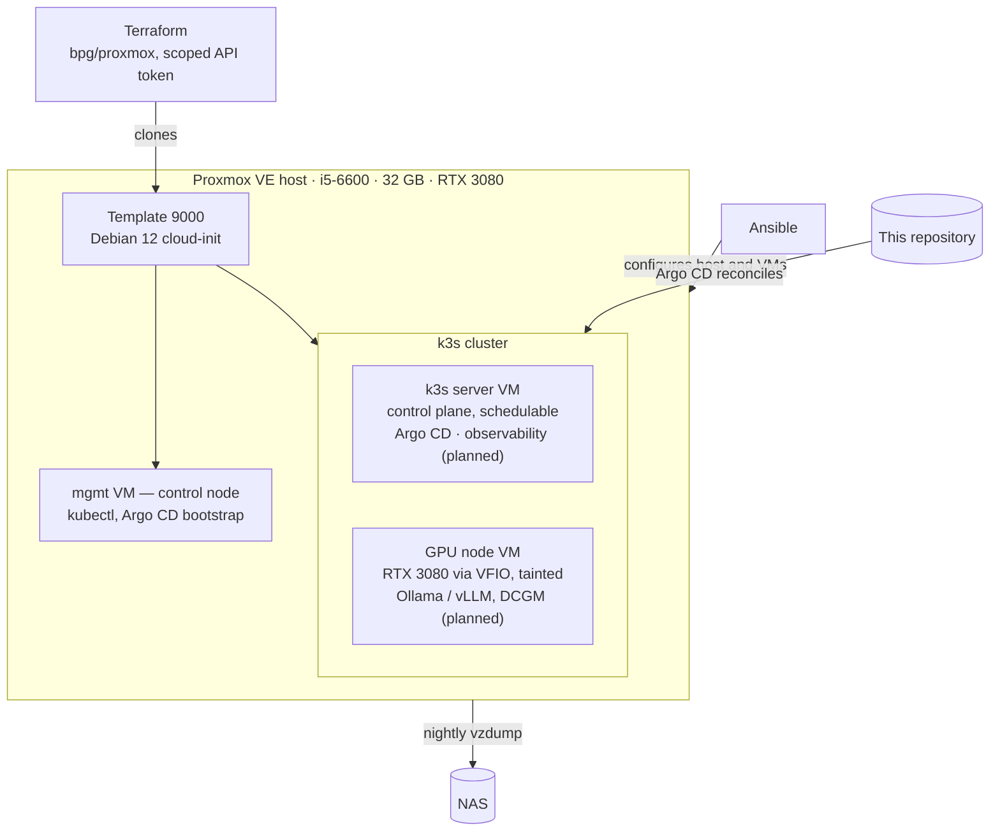

# homelab-iac

A self-hosted home services platform built as code: Proxmox on bare metal, Terraform-provisioned VMs, k3s with GitOps deployment, a GPU-accelerated local LLM, and Prometheus/Grafana observability.

Status: in progress. Phases 1–4 complete: a two-node k3s cluster runs on Terraform-provisioned VMs with the RTX 3080 passed through to the GPU node, Argo CD reconciles the cluster against this repository, and `vzdump` writes nightly VM backups to the NAS.

The design is deliberately heavier than the workload needs. A handful of self-hosted services would run on one machine with `docker compose`. Running them on a GitOps-reconciled k3s cluster with a passed-through GPU and a full observability stack is the exercise itself: the goal is hands-on operation of the patterns production environments actually use, at a scale where a node can be destroyed and rebuilt on a weekday evening.

## Architecture

Three VMs run on the one host, and two of them form the k3s cluster. The server runs the control plane and stays schedulable, which is k3s's default and differs from a kubeadm control plane. The GPU node is tainted, so only workloads that explicitly tolerate the taint land on the card. `mgmt` sits outside the cluster: it holds `kubectl` and ran the one-time Argo CD bootstrap, so losing it costs a convenience rather than capacity. Workloads marked _planned_ arrive in phases 5 and 6.

Two reconciliation loops with different scopes. Ansible is pushed by a human and owns the host and the VMs down to the OS. Argo CD is pulled by the cluster, continuously, and owns everything inside it, including workloads scheduled onto the GPU node. Neither reaches into the other's territory.



## Phases

| #   | Phase                                                                                       | Status  | Doc                                                 |
| --- | ------------------------------------------------------------------------------------------- | ------- | --------------------------------------------------- |
| 1   | Proxmox on bare metal: storage, networking, cloud-init template                             | Done    | [01-proxmox.md](docs/01-proxmox.md)                 |
| 2   | Terraform provisioning with a least-privilege API token                                     | Done    | [02-terraform.md](docs/02-terraform.md)             |
| 3   | GPU hardware validation and passthrough (gate)                                              | Done    | [03-gpu-passthrough.md](docs/03-gpu-passthrough.md) |
| 4   | Ansible + k3s, GitOps bootstrap, nightly VM backups to NAS                                  | Done    | [04-ansible-k3s.md](docs/04-ansible-k3s.md)         |
| 5   | GPU workloads on k3s: NVIDIA stack, local LLM (Ollama, vLLM, llama.cpp), secrets management | In progress | [05-gpu-workloads.md](docs/05-gpu-workloads.md)     |
| 6   | Cluster DNS, observability, and the first real SLO                                          | Planned |                                                     |
| 7   | CI with progressive delivery, automated rollback, automated dependency updates              | Planned |                                                     |
| 8   | Backups, restore drills, failure drills, postmortems                                        | Planned |                                                     |
| 9   | Python triage tool using Prometheus, Loki and the local LLM                                 | Planned |                                                     |

Hardware: [docs/hardware.md](docs/hardware.md). Future work: [docs/backlog.md](docs/backlog.md).

## Repository layout

```
terraform/   VM provisioning (bpg/proxmox)
ansible/     Proxmox host and VM configuration, k3s install, Argo CD bootstrap
kubernetes/  manifests Argo CD reconciles: bootstrap, apps, workloads
docs/        phase write-ups, hardware reference, backlog
```

Secrets, Terraform state and variable files are gitignored; `terraform/example.tfvars` shows the expected variables.

Once the build phases are done, Argo CD will reconcile against a private repository and this one stays as the design record. No secrets move, because none are committed here. The reason is reconnaissance rather than confidentiality: a public repository that pins exact versions and maps internal addresses, hostnames and service inventory is useful to anyone who has already reached the network, and keeping that out of a public index is cheap defense in depth.

---

Claude Opus 5 was used throughout as a pair, for design discussion and for the Terraform, Ansible and Kubernetes manifests here. Every command against the Proxmox host, the VMs and the cluster was run by hand, and every failure recorded in the phase docs is one that actually happened.
