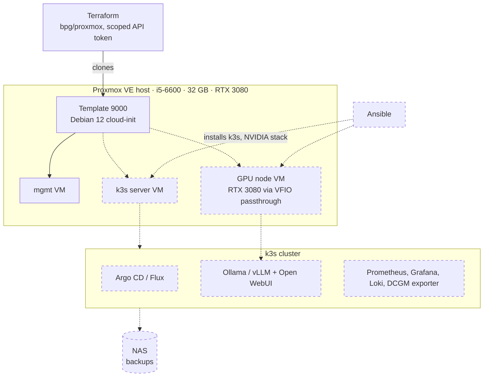

# homelab-iac

A self-hosted home services platform built as code: Proxmox on bare metal, Terraform-provisioned VMs, k3s with GitOps deployment, a GPU-accelerated local LLM, and Prometheus/Grafana observability.

Status: in progress. Phases 1–3 complete; the RTX 3080 is passed through to a Linux VM and validated under sustained load.

## Architecture

Target design. Solid boxes exist today; dashed boxes are planned.



## Phases

| # | Phase | Status | Doc |
| --- | --- | --- | --- |
| 1 | Proxmox on bare metal: storage, networking, cloud-init template | Done | [01-proxmox.md](docs/01-proxmox.md) |
| 2 | Terraform provisioning with a least-privilege API token | Done | [02-terraform.md](docs/02-terraform.md) |
| 3 | GPU hardware validation and passthrough (gate) | Done | [03-gpu-passthrough.md](docs/03-gpu-passthrough.md) |
| 4 | Ansible + k3s, GitOps bootstrap, nightly VM backups to NAS | Planned | |
| 5 | GPU workloads on k3s: NVIDIA stack, local LLM (Ollama, then vLLM; models benchmarked across both) | Planned | |
| 6 | Observability: metrics, logs, GPU metrics, alerts, one SLO | Planned | |
| 7 | CI with progressive delivery and automated rollback | Planned | |
| 8 | Backups, restore drills, failure drills, postmortems | Planned | |
| 9 | Python triage tool using Prometheus, Loki and the local LLM | Planned | |

Hardware: [docs/hardware.md](docs/hardware.md). Future work: [docs/backlog.md](docs/backlog.md).

## Repository layout

```
terraform/   VM provisioning (bpg/proxmox)
docs/        phase write-ups, hardware reference, backlog
```

Secrets, Terraform state and variable files are gitignored; `terraform/example.tfvars` shows the expected variables.
